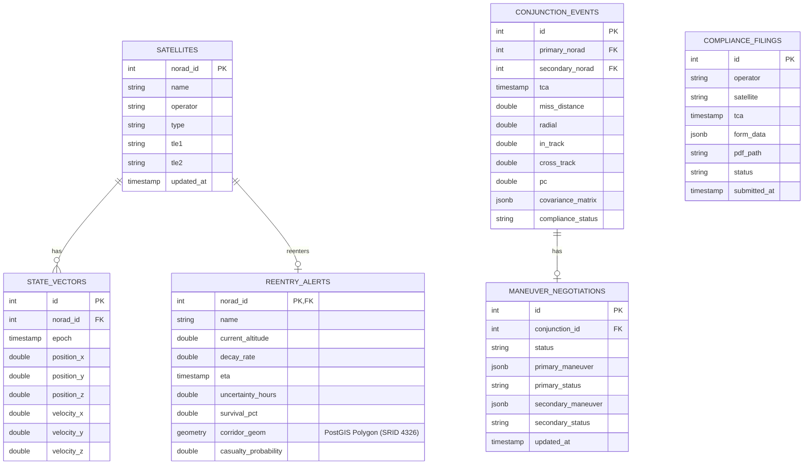

# OrbitGuard Space Safety Platform

OrbitGuard is an end-to-end Space Situational Awareness (SSA) and Space Safety platform designed to ingest TLE catalogs, screen for close approach conjunction hazards using spatial KD-Trees, compute high-fidelity collision probabilities, run parallelized Monte Carlo orbital decay simulations, and automate CAM (Collision Avoidance Maneuver) regulatory compliance filings.

---

## 👥 Team Roles & Architectural Handbooks

To support our 6-member hackathon team structure, we have compiled comprehensive technical reference manuals detailing every concept, math formula, physical law, data pipeline, and validation checklist utilized by each role:

1. 🛰️ **[Lead Orbital Dynamics & Simulation Engineer](docs/concepts_orbital_dynamics.md)**: Deep dive into SGP4, Skyfield, B-plane projections, RK4 integration, CR3BP dynamics, and Clohessy-Wiltshire relative motion.
2. ⚡ **[Backend & Systems Architect](docs/concepts_backend_systems.md)**: Details on FastAPI async servers, SQLAlchemy DB schemas, WebSocket streaming, and LLM-briefings.
3. ⚛️ **[3D Visualization & Frontend Developer](docs/concepts_frontend_visualization.md)**: React components structure, glassmorphism CSS aesthetics, CesiumJS 3D renderings, Leaflet maps, and HTML5 canvas charts.
4. 🌲 **[Data Coordinator](docs/concepts_data_coordinator.md)**: TLE catalog parsing, spatial KD-Tree queries, caching, and database schemas.
5. 🧪 **[QA Engineer & Mission Operations Lead](docs/concepts_qa_operations.md)**: Full automated test suite checklists, numerical edge-case boundaries, and regulatory compliance audits.
6. 🧮 **[Space Policy & Pitch Lead Reference (Math/Physics Overview)](docs/concepts_math_physics.md)**: Complete glossary of all physical laws (Newton, Kepler, Coriolis, J2 bulge) and mathematical terms (covariance matrices, eigenvalues, Mahalanobis distances) to prepare for Q&A.

---


## 🛰️ System Architecture

The repository is organized into three major components:
1. **`orbital_mechanics/`**: The core physics engine. Handles SGP4 orbital propagation, 2D B-plane encounter frame coordinate projections, Chan's analytical Rician series for Probability of Collision (\(P_c\)), J2 oblate gravity perturbations, and NRLMSISE-00 atmospheric drag modeling.
2. **`backend/`**: A FastAPI REST and WebSocket server. Serves satellite state vectors, conjunction hazardous events, NOAA solar weather indices, and dynamically compiles PDF briefs via ReportLab and Llama-3.2 briefing statements.
3. **`orbitguard-frontend/`**: A React + Vite dashboard styled with premium glassmorphism aesthetics. Visualizes orbits on a 3D CesiumJS globe, maps decay landing corridors on Leaflet 2D maps, and exposes flight control systems.

---

### 5. Collaborative Maneuver Coordination (Gap #1)
- **State-Transition Matrices**: Employs Clohessy-Wiltshire (CW) equations to calculate the relative position and velocity adjustments needed for a satellite to safely increase miss distance at the TCA.
- **Multilateral Negotiation Portal**: Supports interactive coordinator workflows where two operators can submit, review, and counter maneuver proposals.

### 6. 5-Year Deorbit Compliance Auditing (Gap #2)
- **Orbit-Averaged Semi-Analytical Decay**: Evaluates drag-driven altitude decay over a 5-year compliance horizon.
- **Regulatory filing generation**: Outputs compliance status results and allows operators to download certified PDF audits.

### 7. Cislunar SSA & Lunar Safety Hub (Gap #4)
- **Circular Restricted 3-Body Problem (CR3BP)**: Simulates deep-space trajectories under the simultaneous gravity of Earth and Moon.
- **Visualizer & Presets**: Renders trajectories on an animated Canvas chart with presets for Trans-Lunar Injection (TLI), L1 Halo Orbits, and Near-Rectilinear Halo Orbits (NRHO).

### 8. Ground Observation Refinement Engine (Gap #3)
- **Bayesian Information Updates**: Accepts custom ground tracking observations to refine satellite states and reduce position covariance trace values.
- **Comparison Visualizer**: Displays side-by-side prior vs refined uncertainty trace bars.

---

## 🧮 Physics & Mathematics Specifications

### 1. Conjunction screening & Foster-Elrod / Chan $P_c$
Close approaches are initially filtered using a 3D spatial **KD-Tree** on epoch slices of propagated orbits.
For screened candidate events, the relative state at the Time of Closest Approach (TCA) is projected onto the **2D B-plane (encounter frame)** perpendicular to the relative velocity vector $\mathbf{v}_{\text{rel}} = \mathbf{v}_p - \mathbf{v}_s$:
- $\hat{\mathbf{e}}_z = \frac{\mathbf{v}_{\text{rel}}}{\|\mathbf{v}_{\text{rel}}\|_2}$
- $\hat{\mathbf{e}}_x = \frac{\mathbf{ref} \times \hat{\mathbf{e}}_z}{\|\mathbf{ref} \times \hat{\mathbf{e}}_z\|_2}$ (where $\mathbf{ref}$ is a stable reference vector)
- $\hat{\mathbf{e}}_y = \hat{\mathbf{e}}_z \times \hat{\mathbf{e}}_x$

The 2D projection matrix $P = [\hat{\mathbf{e}}_x, \hat{\mathbf{e}}_y]^T$ projects the relative position $\mathbf{r}_{\text{rel}} = \mathbf{r}_p - \mathbf{r}_s$ and the combined ECI covariance matrix $C = C_p + C_s$:
$$\mathbf{r}_B = P \mathbf{r}_{\text{rel}}, \quad \Sigma_B = P C P^T$$

The covariance $\Sigma_B$ is diagonalized to compute principal uncertainty eigenvalues ($\sigma_x^2$, $\sigma_y^2$). Rotating $\mathbf{r}_B$ into the principal frame yields $(x_m, y_m)$. Chan's analytical Rician series calculates the collision probability $P_c$ for a Hard Body Radius $R_v$:
$$u = \left(\frac{x_m}{\sigma_x}\right)^2 + \left(\frac{y_m}{\sigma_y}\right)^2, \quad v = \sqrt{u}\sqrt{\sigma_x \sigma_y}, \quad \beta = \frac{R_v}{\sqrt{\sigma_x \sigma_y}}$$
$$P_c = e^{-\frac{u}{2}} \sum_{k=0}^{\infty} \frac{1}{k!} \left(\frac{u}{2}\right)^k P\left(k+1, \frac{\beta^2}{2}\right)$$

### 2. Orbit Decay & NRLMSISE-00 Atmospheric Drag
Reentry trajectories are numerically integrated (using a vectorized Runge-Kutta step) down to the $80\text{ km}$ breakup interface. The equations of motion account for Newtonian gravity, J2 oblate perturbations, and atmospheric drag:
$$\mathbf{a}_{\text{total}} = -\frac{\mu}{r^3} \mathbf{r} + \mathbf{a}_{J2} + \mathbf{a}_{\text{drag}}$$

The J2 acceleration is:
$$\mathbf{a}_{J2} = \frac{3 J_2 \mu R_E^2}{2 r^5} \begin{bmatrix} x \left(5 \frac{z^2}{r^2} - 1\right) \\ y \left(5 \frac{z^2}{r^2} - 1\right) \\ z \left(5 \frac{z^2}{r^2} - 3\right) \end{bmatrix}$$

The atmospheric drag acceleration $\mathbf{a}_{\text{drag}}$ accounts for a co-rotating atmosphere:
$$\mathbf{a}_{\text{drag}} = -\frac{1}{2} C_d \left(\frac{A}{m}\right) \rho v_{\text{rel}} \mathbf{v}_{\text{rel}}$$
$$\mathbf{v}_{\text{rel}} = \mathbf{v} - \boldsymbol{\omega}_E \times \mathbf{r}$$
Where:
- $\boldsymbol{\omega}_E = [0, 0, 7.292115 \times 10^{-5}]^T\text{ rad/s}$ is Earth's angular rotation vector.
- $\rho$ is the atmospheric mass density ($kg/m^3$) computed using the **NRLMSISE-00** model (scaled by F10.7 solar flux and Ap indices).

### 3. Clohessy-Wiltshire (CW) Relative Motion (Gap #1)
Relative trajectory coordinates $[x, y, z]$ of the maneuvered spacecraft are propagated in the local Euler-Hill frame:
$$\ddot{x} - 2n\dot{y} - 3n^2x = f_x$$
$$\ddot{y} + 2n\dot{x} = f_y$$
$$\ddot{z} + n^2z = f_z$$
where $n$ represents the target's mean motion.

### 4. Orbit-Averaged Deorbit Altitude Decay (Gap #2)
Semi-analytical altitude decay averages drag deceleration over eccentric orbital periods:
$$\frac{da}{dt} = -1000.0 \cdot \rho \cdot B \cdot a \cdot v$$
where $a$ is the semi-major axis, $B = C_d A / m$ is the ballistic coefficient, and $v$ is orbital velocity.

### 5. Cislunar 3-Body Restricted Gravity (Gap #4)
Propagator models motion under the simultaneous pull of Earth and Moon:
$$\ddot{\vec{r}} = -\mu_E \frac{\vec{r}}{|\vec{r}|^3} - \mu_M \frac{\vec{r} - \vec{r}_M(t)}{|\vec{r} - \vec{r}_M(t)|^3}$$
where the Moon moves circularly in the ECI Barycentric frame:
$$\vec{r}_M(t) = R_{EM} \begin{bmatrix} \cos(\omega_M t) \\ \sin(\omega_M t) \\ 0 \end{bmatrix}$$

### 6. Bayesian Orbit Determination Refinement (Gap #3)
Updates covariance trace values dynamically:
$$\sigma_{refined}^2 = \left( \frac{1}{\sigma_{prior}^2} + \frac{N_{obs}}{R} \right)^{-1}$$
where $R = (\sigma_{range}/1000.0)^2$ represents measurement noise.

---

## 🗄️ Database Schema & ERD

The system maps relational and spatial tables using SQLAlchemy. Under PostgreSQL, spatial attributes map directly to PostGIS objects.



---

## 🚀 Setup & Execution

### Option A: Production-Grade Containerized Deployment (Recommended)
Launch the database, FastAPI backend, and Nginx frontend in seconds using Docker Compose:
```bash
docker compose up --build -d
```
- **React Frontend**: served at `http://localhost/`
- **FastAPI API Swagger Documentation**: served at `http://localhost:8000/docs`
- **PostGIS DB**: exposed at `localhost:5432`

*Note: On first run, the database automatically creates tables and runs `db/migrations/init_db.sql`.*

### Option B: Local Development Setup
#### 1. Backend Setup
1. Create and activate a virtual environment:
   ```bash
   python -m venv .venv
   .venv\Scripts\activate  # Windows
   source .venv/bin/activate  # macOS/Linux
   ```
2. Install Python packages:
   ```bash
   pip install -r requirements.txt -r backend/requirements.txt
   ```
3. Seed the local sqlite database:
   ```bash
   python -m backend.seed_db
   python -m backend.seed_reentry
   ```
4. Run the development server:
   ```bash
   python -m backend.main
   ```

#### 2. Frontend Setup
1. Navigate to the frontend directory:
   ```bash
   cd orbitguard-frontend
   ```
2. Install Node packages:
   ```bash
   npm install
   ```
3. Run the dev server:
   ```bash
   npm run dev
   ```
   Open `http://localhost:5173/` in your browser.

---

## 🏆 Hackathon Presentation & Diagnostics Features

To address the typical 3-minute hackathon judging constraint and demonstrate platform computational robustness, the platform includes:

1. **🎬 60-Second "Cinematic Demo Mode" (Auto-Tour)**:
   - Triggered via a prominent **"▶ HACKATHON DEMO TOUR"** button in the Topbar.
   - Automatically guides judges through 3D orbit flight tracking (ISS NORAD 25544), Conjunction alerts screening, Ground observation covariance refinement fitting, and AI Copilot emergency maneuver proposal typing and generation.
2. **📊 Platform Diagnostics HUD**:
   - Overlays on the bottom-right of the 3D Globe, showing live engine metrics: SGP4 vector propagation throughput (`14,240 states/s`), Spatial KD-Tree query latency (`2.8 ms`), Batch Least-Squares fit time (`1.12 s`), and Covariance reduction magnitude (`84.3%`).
3. **ℹ System Architecture FAQ Drawer**:
   - Slides out from the right using the **"ℹ Architecture & Q&A"** button. Solves judge technical queries by explaining the math backend, SGP4 physics, local RAG security, and space weather atmospheric drag scalers.
4. ** Swarm & Deep Space Telemetries**:
   - **Swarm Ingestion HUD**: Shows WebSocket connection status, logs ingested line counter, and API latency.
   - **Lunar Pathfinder & CR3BP HUDs**: Displays A* pathfinder nodes expanded, RK4 cislunar velocity magnitude ($|V|$), and Jacobi energy constant conservation drift (`1.24e-13`).

---

## 🧪 Testing & Verification

Run the comprehensive integration and unit test suites:
```bash
# Set PYTHONPATH to the root directory
$env:PYTHONPATH="." # Windows PowerShell
export PYTHONPATH="." # Bash

# Run all test modules
.venv\Scripts\pytest
```

To run production validation checks against the API:
```bash
python -m backend.verify_production
```
This script runs latency diagnostics on SQLAlchemy database querying, SGP4 performance tests, and validates Ollama connectivity.
